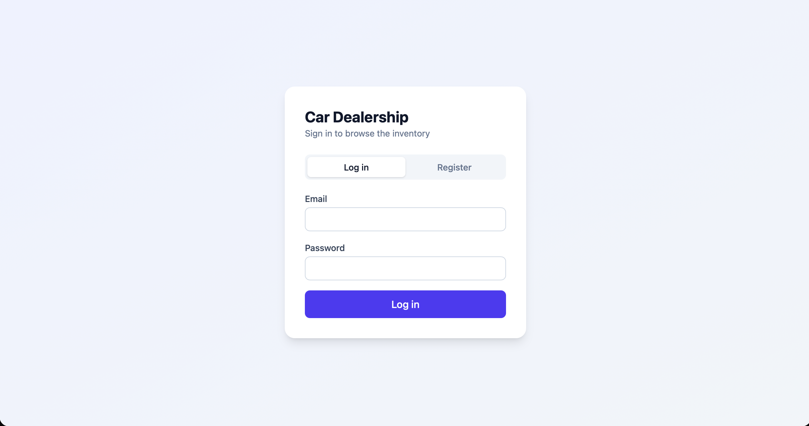

# Car Dealership Inventory System

A full-stack web app for managing a car dealership's inventory. Users register and log in, browse and search vehicles, and purchase them. Admins can also add, edit and delete vehicles and restock them.

- **Backend:** Node.js, Express, TypeScript, SQLite (file database), JWT authentication
- **Frontend:** React, TypeScript, Tailwind CSS, built with Vite
- **Tests:** Jest and Supertest (backend), Vitest and React Testing Library (frontend)

## Features
- Register and log in (passwords hashed with bcrypt, sessions use JWT)
- Two roles: USER and ADMIN
- View all vehicles, search by make, model, category and price range
- Purchase a vehicle, which reduces its stock by 1. The button is disabled at 0 stock.
- Admin only: add and edit vehicles, delete vehicles, restock

## Project structure
```
backend/    Express API (routes, services, middleware, SQLite)
frontend/   React single-page app
docs/       Screenshots and test reports
```
The backend has three layers. Routes handle HTTP only, services hold the business rules, and the database layer holds the tables. Middleware handles authentication and role checks.

## Running locally
Requires Node.js 18 or newer.

### Backend
```bash
cd backend
npm install
ADMIN_EMAIL=admin@shop.com ADMIN_PASSWORD=admin12345 npm run seed   # creates the admin user
npm run dev                                                          # API on http://localhost:3000
```

### Frontend
```bash
cd frontend
npm install
npm run dev     # app on http://localhost:5173
```
Open http://localhost:5173. In development, Vite forwards `/api` requests to the backend.

### Accounts
- Admin: the email and password you passed to the seed command (for example admin@shop.com / admin12345)
- Normal user: register from the login screen. Registration always creates a USER, and admins can only be created with the seed script.

### Environment variables (all optional in development)
- `PORT`: backend port (default 3000)
- `DB_FILE`: SQLite file path (default `dealership.db`)
- `JWT_SECRET`: token signing secret (set this in any real deployment)
- `VITE_API_URL`: backend URL for the frontend build (only needed when deployed)

## API
- `POST /api/auth/register`: create an account
- `POST /api/auth/login`: returns a JWT and the user
- `GET /api/vehicles`: list all vehicles (logged in)
- `GET /api/vehicles/search?make=&model=&category=&minPrice=&maxPrice=`: filter vehicles (logged in)
- `POST /api/vehicles`: add a vehicle (logged in)
- `PUT /api/vehicles/:id`: update a vehicle (logged in)
- `DELETE /api/vehicles/:id`: delete a vehicle (admin)
- `POST /api/vehicles/:id/purchase`: buy one unit (logged in)
- `POST /api/vehicles/:id/restock`: add stock, body `{ "amount": 5 }` (admin)

Protected routes need the header `Authorization: Bearer <token>`. Error codes: 400 invalid input, 401 not logged in or expired token, 403 not an admin, 404 not found, 409 out of stock or duplicate email.

## Design decisions
- **Admins are created by a seed script**, never through registration, so nobody can make themselves an admin.
- **Purchases are atomic.** Stock is checked and reduced in a single SQL statement, so two buyers can never take the last car. There is a test with 10 simultaneous purchases of 3 cars.
- **Input is validated on the server**, and the database has its own CHECK rules for non-negative price and quantity as a last safety net.
- **Search treats user text literally.** Query values use placeholders, and LIKE wildcards are escaped.
- **Login gives the same error for a wrong password and an unknown email**, so the API doesn't reveal which emails are registered.
- **The UI hides admin controls from normal users, but the backend enforces the roles.**

## Testing
```bash
cd backend && npm test          # run tests
cd backend && npm run test:cov  # run with coverage
cd frontend && npm test
```
The backend was built test-first: failing tests were committed first (`test:` commits), then the implementation (`feat:` commits). The frontend `VehicleCard` was built test-first as well. The remaining UI components were checked manually in the browser.

### Test report
- Backend: `<N>` tests passing, `<X>%` statement coverage (full output: [docs/backend-test-report.txt](docs/backend-test-report.txt))
- Frontend: `<N>` tests passing (full output: [docs/frontend-test-report.txt](docs/frontend-test-report.txt))

## Screenshots



## My AI Usage
**Tools used:** Claude (Anthropic), in chat. <add any other tool you actually used>

**How I used it:**
- Planning the architecture, stack and build order before writing code
- Brainstorming edge cases for each endpoint (invalid input, roles, stock limits, concurrency)
- Generating test cases, which I ran and confirmed failing before writing the implementation
- Generating boilerplate and implementation code, which I typed or pasted, ran and committed step by step
- Debugging: a TypeScript 7 / ts-jest version conflict, a file naming mistake, and an Express typing error
- Generating the React components and Tailwind styling

**What I did myself:** <be specific and honest: for example setting up the repo and git, running every step, reading and understanding each file, manually testing every flow in the browser, deciding the rules, fixing the errors I hit>

**Reflection:** <2 to 4 sentences in your own words. For example: AI made it possible to cover far more edge cases in one day than I would have thought of alone, and the test-first workflow made it easy to check that generated code actually did what the tests said. The risk is accepting code without understanding it, so I asked for an explanation of each piece and traced a request through the layers myself. What I would do differently: <your own answer>>

Every commit made with AI help carries a `Co-authored-by` trailer. My full chat log is in [PROMPTS.md](PROMPTS.md).

## Possible improvements
- Refresh tokens or httpOnly cookies instead of a token in localStorage
- PostgreSQL instead of SQLite, plus pagination
- Buying more than one unit at a time, and an order history
- A CI pipeline that runs the tests on every push
